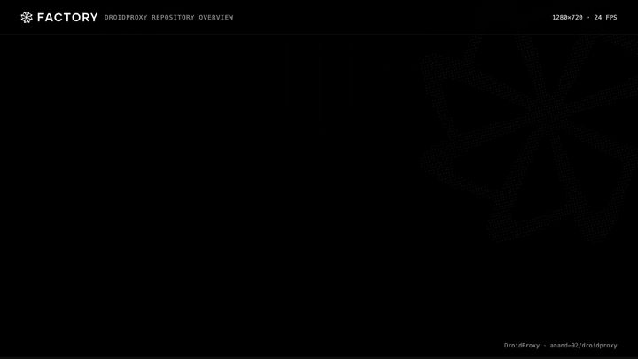
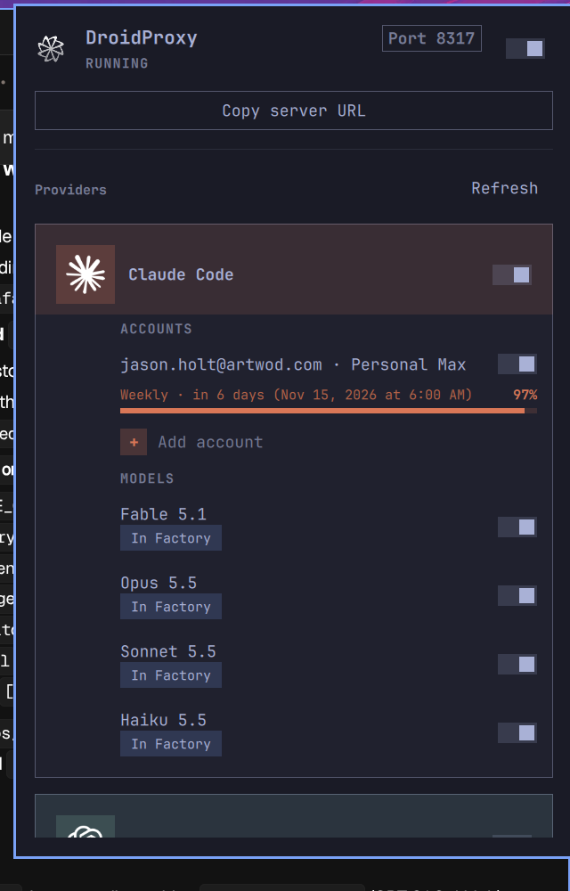

# DroidProxy for Omarchy

<p align="center">
  
</p>

<p align="center">
  <strong>Your Claude, Codex, Gemini, Grok, Meta Muse, Kimi, and JetBrains Junie subscriptions — on Omarchy, for <a href="https://app.factory.ai"></a> Droids.</strong>
</p>

A native Linux port of [DroidProxy](https://github.com/anand-92/droidproxy) for [Omarchy](https://omarchy.org). Background service and an Omarchy bar panel. Built on [CLIProxyAPI](https://github.com/router-for-me/CLIProxyAPI).

<p align="center">
  
</p>

## Install

One command. No `sudo`.

```bash
curl -fsSL https://raw.githubusercontent.com/nikships/droidproxy-omarchy/main/install.sh | bash
```

That downloads the latest release for your CPU (x86_64 or arm64), verifies the SHA-256 checksum and ed25519 signature, installs into `~/.local/share/droidproxy`, puts `droidproxy` on your `PATH`, enables the systemd user service, and adds the Omarchy bar plugin plus a launcher entry.

### Updates

Checks GitHub Releases once a day (Sparkle-style). Desktop notification with an **Install** button when something new is out; Settings → Updates can auto-install. Or from a terminal:

```bash
droidproxy update check
droidproxy update install
droidproxy rollback
```

### Uninstall

```bash
droidproxy uninstall          # keeps your accounts and settings
droidproxy uninstall --purge  # also removes DroidProxy's settings
```

## Features

- **One-click OAuth auth** -- Claude Code, Codex, and Antigravity login from Settings, with credential monitoring and automatic OAuth token refresh. Multiple accounts per provider, with per-account enable/disable.
- **Grok and Meta Muse** -- Device-code sign-in for SuperGrok / X Premium+ (Grok 4.7 and Grok 4.7 Fast) and Meta Muse (Muse Wonder 1.0 and Muse Wonder Full 1.0, with Contributor mode).
- **Kimi and Junie** -- Moonshot Kimi K3.1 Pro, K3.1 Pro Highspeed, and K3, plus Junie Opus 5.5 and Sol 6.1 through a JetBrains AI subscription (API key pasted in the panel).
- **Every model, every reasoning level** -- Fable 5.1, Opus 5.5, Sonnet 5.5, Haiku 5.5, GPT 6 Astra, GPT 6.1 Sol, GPT 6.1 Terra, GPT 6 Luna, Gemini 4 Argon, Gemini 4 Carbon, Gemini 4 Hydrogen, Gemini 3.8 Flash, Kimi K3.1 Pro, and more — registered as Factory custom models with their full set of native reasoning levels. Pick the effort per session in Droid's model selector.
- **Fast Mode** -- Optional `service_tier=priority` for GPT 6 Astra, GPT 6.1 Sol, GPT 6.1 Terra, and GPT 6 Luna. Grok 4.7 Fast is a separate SuperGrok model (`grok-4.7-build-fast`).
- **Account failover** -- Round-robin by default, or sequential failover that rides one account until its quota runs out.
- **Usage tracking** -- Claude, Codex, Grok, and Meta Muse OAuth quota windows (5-hour + weekly) as quota bars in the bar panel, just like the Mac app. Click a quota row to copy a `curl` for that account's live quota (`GET /droidproxy/usage` on the proxy port), so an agent can check its own quota before it runs out.
- **Auto-start daily** -- Optional per-provider time for Claude, Codex, and Meta Muse: DroidProxy sends one tiny request per account then, so the 5-hour window is already underway when you start work and resets sooner in your day. Accounts on weekly-only plans (no 5-hour window) don't show it.
- **Grok Imagine and GPT Image** -- OpenAI-compatible image generation through your Grok or Codex subscription. See [Image generation skills](#image-generation-skills).
- **Remote access** -- Optional remote management with a secret key, and a configurable bind address (beta).

<p align="center">
  
</p>

## Using it

- **Bar panel** -- click the bar icon to open the panel: server, quota bars, accounts, Factory models, and the provider switches. The icon tint shows the server state. The panel is the only settings surface; there is no settings web page.
- **Settings** -- the bar panel, the launcher entry, or `droidproxy open`. Server control, provider accounts, OAuth quota gauges, Factory models, remote access, and updates.
- **Factory models** -- in the panel, **Factory custom models → Apply** writes DroidProxy's enabled models into `~/.factory/settings.json` (timestamped backup first). Each model can be switched off under its provider; switching one off also deletes its DroidProxy entry from the Factory config, and switching it back on writes it again. In Droid, use `/model` and search for "DroidProxy:".
- **Banked resets** -- Codex and Claude accounts with banked usage resets show the count next to their quota gauges. **Use reset** spends one, after a confirmation.

See [SETUP.md](SETUP.md) for provider details and manual Factory configuration. **(OR use the 1-click options in the UI!)**

### Command line

```
droidproxy status              show server and provider status
droidproxy start|stop|restart  control the proxy servers
droidproxy open                open the bar panel
droidproxy login <provider>    add an account (claude, codex, antigravity, grok, meta)
droidproxy update [check|install]
droidproxy rollback            go back to the previously installed version
droidproxy logs                follow the service log (journalctl)
droidproxy version
```

## How it works

```
Droid ──► :8317 ThinkingProxy ──► :8318 CLIProxyAPI ──► provider
                    └──► api.x.ai / cli-chat-proxy.grok.com / api.meta.ai (Grok, Muse Responses)
```

- `droidproxy serve` runs as a systemd user service. ThinkingProxy on `localhost:8317`, bundled CLIProxyAPI on `127.0.0.1:8318`.
- The Omarchy shell plugin talks to the service over a private Unix socket (`$XDG_RUNTIME_DIR/droidproxy/control.sock`). See [docs/control-api.md](docs/control-api.md).
- Service logs: `journalctl --user -u droidproxy`. Per-request reasoning log: `~/.local/state/droidproxy/droidproxy-debug.log`.

### Request journal

Off by default. Turn it on with the control API setting `requestJournal` ([docs/control-api.md](docs/control-api.md)). While it is on, ThinkingProxy appends one JSON line per inference request it relays to CLIProxyAPI to `~/.droidproxy/journal/requests-YYYY-MM.jsonl` (directory 0700, files 0600, one file per UTC month). Each line records the request's timing, endpoint, requested and reported model, HTTP status, how the relay ended, the CLIProxyAPI seat that served it (auth index, plus the auth file name, email, and Claude organization or Codex account id when they can be read safely), the client's explicit session key, and the token usage the response reported. It holds no prompts, response content, credentials, or other headers. Grok, Meta Muse Responses, and token-count requests are not recorded. The format is defined in [contract/request-journal-v1.md](contract/request-journal-v1.md).

## Image generation skills

If you have **Grok** and/or **Codex** connected, you can generate images through the same proxy:

```bash
mkdir -p ~/.factory/skills
cp -R skills/grok-imagine ~/.factory/skills/
cp -R skills/gpt-image ~/.factory/skills/
```

Both skills post to `http://localhost:8317/v1/images/generations` with `Authorization: Bearer dummy-not-used`:

- **Grok** -- model `grok-imagine-image-2.0`. ThinkingProxy injects your Grok OAuth token and forwards to xAI.
- **GPT** -- model `gpt-image-2.6-flare` (fast default) or `gpt-image-2.6-sunburst` (maximum quality). The skill can target an older id, including 2.5, when this backend rejects 2.6. CLIProxyAPI injects your Codex OAuth token. Requires ChatGPT Plus/Pro.

## Requirements

- Omarchy (Arch Linux + Hyprland + omarchy-shell), x86_64 or arm64 (including Asahi Linux)
- `curl` and `tar` for the installer (ship with Omarchy)

## Build from source

```bash
go test ./...
scripts/dev.sh                          # build into build/dev and run the daemon in the foreground
scripts/build-release.sh 1.2.3 arm64    # build a release tarball into dist/
```

## Releases

Every push to `main` (except documentation-only changes) runs the tests, bumps the patch version, builds x86_64 and arm64 tarballs, signs them, and publishes a GitHub Release. Installed copies pick it up through the updater. A scheduled workflow opens a pull request whenever a new CLIProxyAPI version comes out.

## Contributors

- [Nik Anand](https://github.com/nikships) — creator and maintainer
- [Jason Holt](https://github.com/kingdomseed) — native panel redesign, per-model Factory toggles, banked resets

## License

MIT
